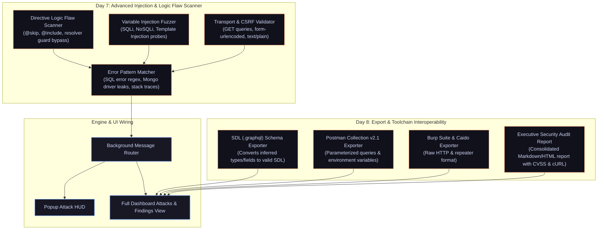

# 📋 GraphQL Hunter — Next-Day Development Plan (Day 7 & Day 8)

**Project:** GraphQL Hunter (Firefox WebExtension for GraphQL Security Auditing)  
**Date:** October 11, 2026 (Next-Day Sprint)  
**Status:** Days 1–7 Complete (100%); Day 8 (Exporters & Toolchain Interoperability) Ready to Start  

---

## 🧭 Executive Summary & Milestone Progress

GraphQL Hunter has completed all core interception, AST parsing, zero-introspection schema reconstruction, differential authorization testing, findings evidence management, and the active attack engine across both the popup HUD and full-screen dashboard.

### Milestone Status

| Sprint | Feature Area | Status | Deliverables & Completed Scope |
| :--- | :--- | :---: | :--- |
| **Day 1** | Network & DOM Interception | ✅ Complete | Firefox `webRequest.filterResponseData` StreamFilter + DOM `page-hook` monkey-patching. |
| **Day 2** | AST Analysis & Risk Engine | ✅ Complete | Official `graphql` AST parsing (`visit`), variable extraction, heuristic risk scorer. |
| **Day 3** | Schema Rebuilding & Complexity | ✅ Complete | Zero-introspection schema model, recursive depth & list multiplier scoring. |
| **Day 4** | Authorization Replay Engine | ✅ Complete | Replay tests (`NO_AUTH`, `STRIP_COOKIES`, `MUTATE_ID`), response diffing (`VULNERABLE` / `PROTECTED`). |
| **Day 5** | Findings & Dashboard v1 | ✅ Complete | Finding persistence, curl generation, Markdown/JSON export, full dashboard UI. |
| **Day 6** | Active Attack Engine & UI Integration | ✅ Complete | 7 attack vectors in `attack-engine.ts`, popup HUD triggers, **full dashboard Attacks tab, live job table, stats bar, and detail drawer**. |
| **Day 7** | Advanced Injection & Logic Flaw Scanner | ✅ Complete | Directive bypass (`@skip`/`@include`), variable fuzzing (SQLi/NoSQLi/SSTI), HTTP method/Content-Type CSRF checks, popup & dashboard UI. |
| **Day 8** | Exporters & Toolchain Interoperability | ⏳ Planned | SDL (`.graphql`) schema export, Postman Collection v2.1, Burp Suite request/repeater exports, HTML report generator. |

---

## 🏗️ Architecture & Next-Day Implementation Flow



---

## 🎯 Day 7 Sprint: Advanced Injection & Logic Flaw Scanner

**Goal:** Expand testing beyond IDOR and DoS to backend injection vectors, resolver authorization directive bypasses, and transport-level CSRF/preflight bypasses.

---

### Phase 1: Directive Logic Flaw Scanner

**File:** `extension/analysis/injection-scanner.ts`

- [x] **1.1 Directive Bypass AST Transformer:**
  - Parse captured query using official `graphql/language` parser and `visit`.
  - Locate sensitive fields (e.g. `user`, `account`, `role`, `email`, `token`, `secret`).
  - Generate mutated queries with conditional execution directives:
    - `@skip(if: false)` — forces evaluation while evading naive resolver field checks.
    - `@include(if: true)` — tests whether directive-level execution alters resolver authorization.
    - `@skip(if: true)` — control baseline verifying directive execution is respected.
- [x] **1.2 Custom / Unauthorized Directive Probing:**
  - Test custom directive handling: `@admin`, `@internal`, `@auth(role: "ADMIN")`.
  - Detect whether the server leaks directive validation errors or falls back to execution.
- [x] **1.3 Logic Flaw Verification:**
  - Compare baseline response data with directive-injected response data.
  - Flag `DIRECTIVE_AUTH_BYPASS` when a previously unauthorized/empty field returns valid data under `@skip(if: false)` or `@include(if: true)`.

---

### Phase 2: Variable Injection Fuzzer (SQLi / NoSQLi / SSTI)

**Files:** `extension/analysis/injection-scanner.ts` & `extension/analysis/wordlist.ts`

- [x] **2.1 Variable Target Identification:**
  - Extract variable definitions and references from captured operations (`$id`, `$filter`, `$search`, `$query`, `$sort`, `$limit`).
  - Identify string, integer, and JSON scalar variables suitable for fuzzing.
- [x] **2.2 Non-Destructive Payload Dictionary:**
  - **SQL Injection Probes (Syntax & Boolean):**
    - `' OR '1'='1`
    - `1' ORDER BY 1--`
    - `' UNION SELECT NULL--`
    - `admin'--`
  - **NoSQL Injection Probes (MongoDB / CouchDB):**
    - `{"$gt": ""}`
    - `{"$ne": null}`
    - `{"$regex": ".*"}`
  - **Server-Side Template Injection (SSTI / Expression Language):**
    - `${7*7}`
    - `{{7*7}}`
    - `#{7*7}`
- [x] **2.3 Error & Reflection Signature Matcher:**
  - Implement heuristic error matching for database and runtime leakages:
    - **PostgreSQL / MySQL:** `syntax error at or near`, `check the manual that corresponds to your MySQL server version`, `You have an error in your SQL syntax`.
    - **SQLite:** `unrecognized token`, `incomplete input`.
    - **MongoDB / Mongoose:** `Cast to ObjectId failed`, `MongoError`, `$where is not allowed`.
    - **Template Engines:** `49` reflection in response text without expression syntax.
  - Classify findings: `CRITICAL` for syntax-confirmed injection, `HIGH` for unhandled database driver exception leaks.

---

### Phase 3: Transport, HTTP Method & Content-Type CSRF Validator

**File:** `extension/analysis/injection-scanner.ts`

- [x] **3.1 GET-Based Query Delivery:**
  - Dispatch intercepted query using HTTP `GET` with URL parameters: `GET /graphql?query={operation}&variables={...}`.
  - Evaluate if the endpoint processes mutations or sensitive queries via `GET`.
  - Flag `CSRF_VIA_GET` risk when mutations are accepted without state-changing token protection.
- [x] **3.2 Simple Content-Type Preflight Bypass:**
  - Test submitting GraphQL payloads using simple CORS MIME types:
    - `application/x-www-form-urlencoded` (`query=...&variables=...`)
    - `text/plain`
  - Check whether the GraphQL server parses the body and returns `200 OK` with JSON data.
  - Flag `CORS_PREFLIGHT_BYPASS` if queries succeed without requiring preflight `OPTIONS` requests (`Access-Control-Allow-Origin: *` or missing CORS enforcement).

---

### Phase 4: Attack Engine & Background Integration

**Files:** `extension/types/graphql.ts`, `extension/analysis/attack-engine.ts`, `extension/background/background.ts`

- [x] **4.1 Extend Domain Types:**
  - Add attack types to `AttackType`:
    - `'DIRECTIVE_BYPASS'`
    - `'VARIABLE_INJECTION'`
    - `'GET_METHOD_TAMPER'`
    - `'CONTENT_TYPE_CSRF'`
  - Add `InjectionFinding` structure with payload, parameter name, error signature matched, and proof-of-concept cURL.
- [x] **4.2 Update Attack Engine Runner:**
  - Add dispatch handlers for the 4 new attack types.
  - Collect and categorize injection hits into `FuzzHit[]` with detailed evidence.
- [x] **4.3 Message Router Handlers:**
  - Expose `RUN_INJECTION_SCAN` message action in `background.ts`.
  - Broadcast live results via `ATTACK_RESULT` to active popups and dashboards.

---

### Phase 5: UI & Dashboard Integration

**Files:** `extension/popup/popup.html`, `extension/dashboard/dashboard.html`, `extension/dashboard/dashboard.ts`

- [x] **5.1 Popup Attack HUD:**
  - Add one-click attack triggers for:
    - `⚡ Directive Bypass Scan`
    - `💉 Variable Fuzzing`
    - `🌐 Transport / CSRF Test`
- [x] **5.2 Full Dashboard Attacks View:**
  - Render new attack types with dedicated badge tags (`DIRECTIVE`, `INJECTION`, `TRANSPORT`).
  - In the attack detail drawer:
    - Highlight matched error regex patterns in red monospace boxes.
    - Show side-by-side query diffs (original query vs directive-injected query).
    - Provide reproduction terminal cURL commands.

---

## 📦 Day 8 Sprint: Toolchain Interoperability & Exporters

**Goal:** Export captured assets, reconstructed schemas, and security findings into industry-standard formats (Burp Suite, Postman, SDL).

---

### Phase 6: Zero-Introspection SDL (.graphql) Exporter

**File:** `extension/analysis/schema-builder.ts`

- [ ] **6.1 SDL Generation Engine (`exportSchemaAsSDL`):**
  - Iterate through `SchemaModel.types` (reconstructed types, fields, arguments, and scalar guesses).
  - Generate clean GraphQL Schema Definition Language (`.graphql`):
    ```graphql
    # Reconstructed by GraphQL Hunter (Zero-Introspection)
    # Target Endpoint: https://api.target.com/graphql

    type Query {
      user(id: ID!): User
      searchItems(query: String!): [Item]
    }

    type Mutation {
      updateUserProfile(id: ID!, email: String): User
    }
    ```
- [ ] **6.2 UI Export Triggers:**
  - Add "Export SDL (.graphql)" button to Schema tab in popup and dashboard.
  - Implement browser file download via Blob / data URL.

---

### Phase 7: Postman & Burp Suite Format Exporters

**File:** `extension/analysis/evidence-utils.ts`

- [ ] **7.1 Postman Collection v2.1 Exporter (`exportPostmanCollection`):**
  - Transform captured GraphQL requests into a valid Postman Collection v2.1 JSON file.
  - Include headers, endpoint URLs, queries, and parsed JSON variables.
  - Group operations into folders by `OperationType` (Queries, Mutations).
- [ ] **7.2 Burp Suite & Caido Raw Request Exporter (`exportBurpRawRequests`):**
  - Generate raw HTTP/1.1 request texts suitable for pasting directly into Burp Suite Repeater or Caido Replay.
- [ ] **7.3 Consolidated Security Audit Report (`exportAuditReport`):**
  - Generate executive-ready HTML/Markdown report compiling all findings, attack jobs, vulnerability evidence, CVSS risk grades, and remediation advice.

---

## 🗂️ Targeted File Map

| File | Status | Planned Modifications |
| :--- | :---: | :--- |
| `extension/types/graphql.ts` | **Modify** | Add `DIRECTIVE_BYPASS`, `VARIABLE_INJECTION`, `GET_METHOD_TAMPER`, `CONTENT_TYPE_CSRF` types. |
| `extension/analysis/injection-scanner.ts` | **Create** | Directive injection, variable fuzzing (SQLi/NoSQLi/SSTI), and transport validator. |
| `extension/analysis/attack-engine.ts` | **Modify** | Wire new Day 7 injection attacks into payload generation and execution dispatch. |
| `extension/analysis/schema-builder.ts` | **Modify** | Implement `exportSchemaAsSDL(model: SchemaModel): string` SDL generator. |
| `extension/analysis/evidence-utils.ts` | **Modify** | Implement Postman v2.1, Burp raw format, and HTML report generators. |
| `extension/background/background.ts` | **Modify** | Add `RUN_INJECTION_SCAN` message actions and route injection events. |
| `extension/popup/popup.html` / `popup.ts` | **Modify** | Add Day 7 attack triggers and SDL download button in schema view. |
| `extension/dashboard/dashboard.html` | **Modify** | Add export buttons (SDL, Postman, Burp) and injection drawer cards. |
| `extension/dashboard/dashboard.ts` | **Modify** | Wire export event listeners and format injection fuzz results. |
| `README.md` | **Modify** | Synchronize roadmap milestones, completed Day 6 attack engine, and Day 7 scanning capabilities. |

---

## 🧪 Verification & QA Acceptance Criteria

1. **Compilation Cleanliness:**
   - `npm run build` completes with zero TypeScript or Webpack errors.
2. **Directive Injection Verification:**
   - Querying a sample GraphQL endpoint with `@skip(if: false)` successfully passes through AST parsing and produces valid payloads.
3. **Variable Fuzzing & Regex Verification:**
   - Test queries containing SQL syntax errors trigger `CRITICAL` or `HIGH` fuzz hits in the attack engine.
4. **SDL Export Accuracy:**
   - Exported `.graphql` file parses cleanly in standard GraphQL tools (e.g. Apollo Workbench, GraphQL CLI).
5. **Postman Collection Validity:**
   - Exported Postman JSON imports directly into Postman without schema errors.
